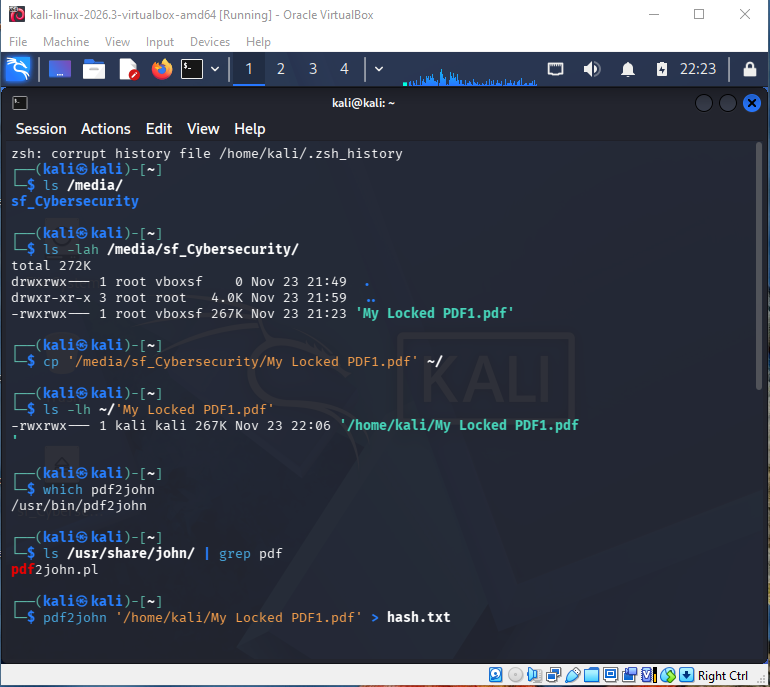
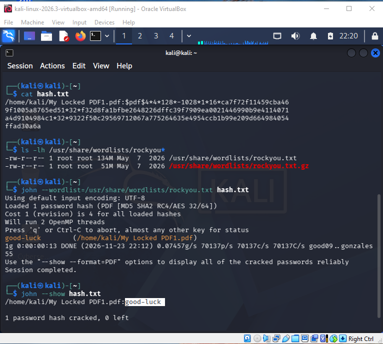

# Password Cracking with John the Ripper (JTR)
**NetworkWalks Cybersecurity Internship — Batch B084 — Week 3 (W3-PM1)**

| | |
|---|---|
| **Author** | Usoro, Iniubong Etido |
| **Program** | NetworkWalks Cybersecurity Internship |
| **Week / Module** | Week 3 — W3-PM1: Password Cracking with JTR |
| **Environment** | Kali Linux on Oracle VirtualBox |

---

## 📋 Overview

This repo documents the Week 3 password-cracking practical: extracting password hashes from two
protected PDF files and recovering the passwords with **John the Ripper (JTR)** on Kali Linux, plus
the NetworkWalks training-module evidence and the challenge flags captured along the way.

## 🎯 Objectives

- Prepare password-protected PDF files in the Kali Linux working directory.
- Extract compatible PDF password hashes using `pdf2john`.
- Run John the Ripper with the RockYou wordlist against each hash.
- Verify each recovered password using the JTR `--show` function.
- Record the NetworkWalks training-interface results and challenge flags.

## 🛠 Tools & Resources

| Tool / Resource | Purpose |
|---|---|
| Kali Linux | Operating system used for the practical work |
| Oracle VirtualBox | Virtual machine environment |
| John the Ripper | Dictionary-based password recovery utility |
| pdf2john | Extracts password-hash data from a protected PDF |
| RockYou wordlist | Candidate password list used during testing |
| NetworkWalks Hash Calculator | Training tool for extracting a PDF hash |
| NetworkWalks Dictionary Attack Lab | Training interface showing candidate testing and a match |

---

## 🔍 Practical Workflow

### 1. Prepare PDF1 (`My Locked PDF1.pdf`) and extract its hash

The file was located in the shared VirtualBox folder `/media/sf_Cybersecurity/`, copied into the Kali
home directory, and `pdf2john` was used to extract a crackable hash into `hash.txt`.



### 2. Crack PDF1 with John the Ripper

```
john --wordlist=/usr/share/wordlists/rockyou.txt hash.txt
john --show hash.txt
```

John the Ripper cracked the hash in 13 seconds. `--show` confirmed the recovered password: **`good-luck`**.



### 3. Prepare PDF2 (`My Locked PDF2.pdf`) and extract its hash

A second protected file was copied from the shared folder, and `pdf2john` extracted its hash into `hash2.txt`.

.png)

### 4. Crack PDF2 with John the Ripper

John the Ripper completed almost instantly against `hash2.txt`. `--show` confirmed the recovered password: **`password1`**.


---

## 🏁 NetworkWalks Training Modules

Cover pages issued for the two related NetworkWalks training challenges:

| JTR module | Hash Calculator / NetworkWalks Tools module |
|---|---|
|  |  |

## 🚩 Flags Captured

| Module | Flag |
|---|---|
| JTR module | `nw{cybersecurity_flag_captured_2608}` |
| Hash Calculator / NetworkWalks Tools module | `nw{networkwalks_persistence_jtr_270521}` |


> **Note:** the passwords and flags above come from different files and stages of the exercise and
> should not be treated as interchangeable.

---

## ✅ Completion Status

| Week 3 module | Status |
|---|---|
| W3-PM1 – Password Cracking with JTR | ✅ Evidence documented (two PDFs cracked locally) |
| W3-PM2 – Password Cracking with NetworkWalks Tools | ✅ Module cover and flag-capture evidence documented |

## ⚠️ Ethical & Safety Note

Password recovery and security testing were performed only on files prepared for this internship lab
exercise. These techniques must only be used on files, accounts, or systems you own or are explicitly
authorized to test.

---

**Author:** Usoro, Iniubong Etido — NetworkWalks Cybersecurity Internship, Batch B084, Week 3
